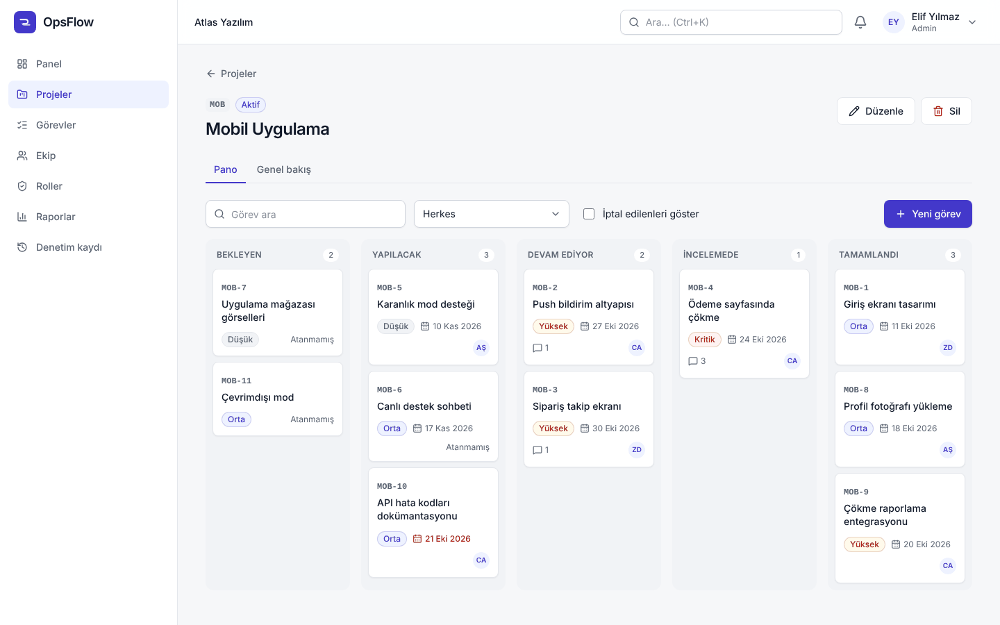
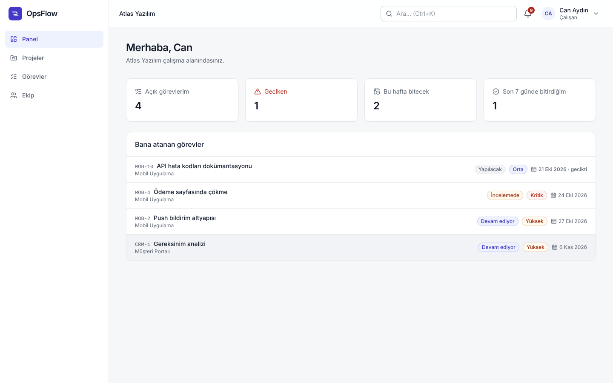
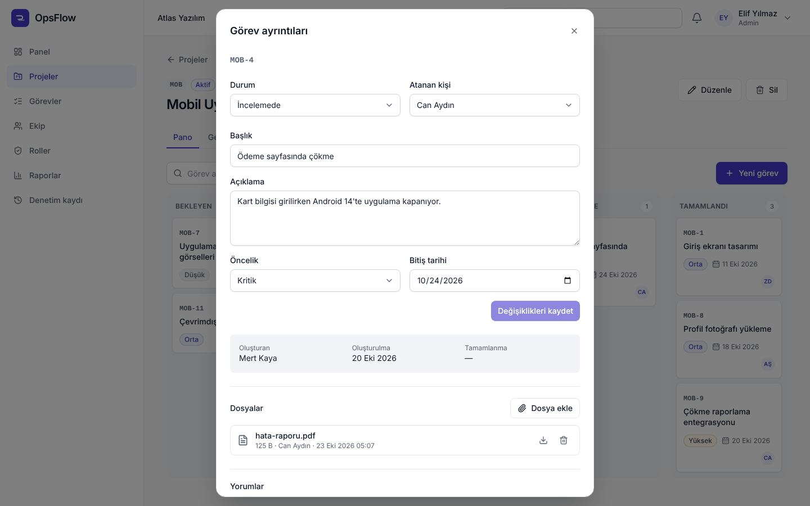
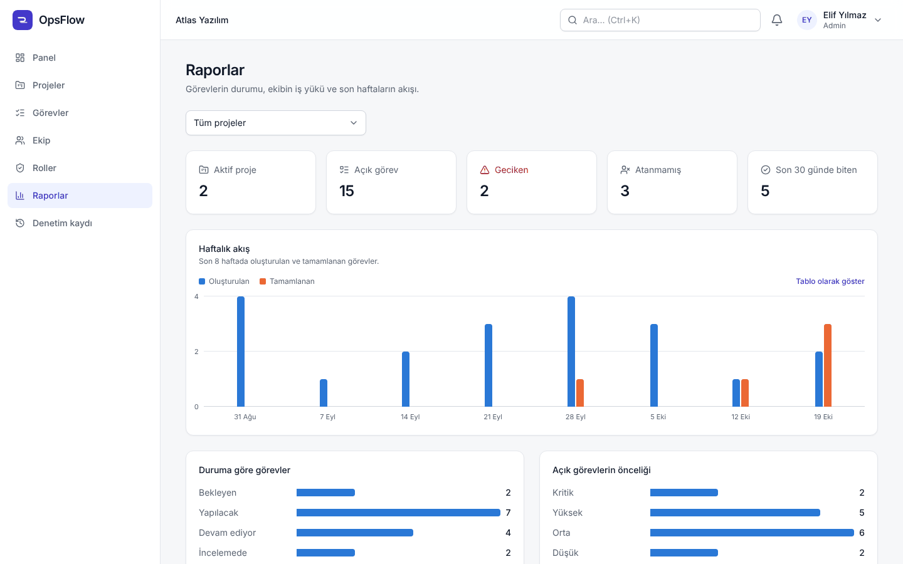
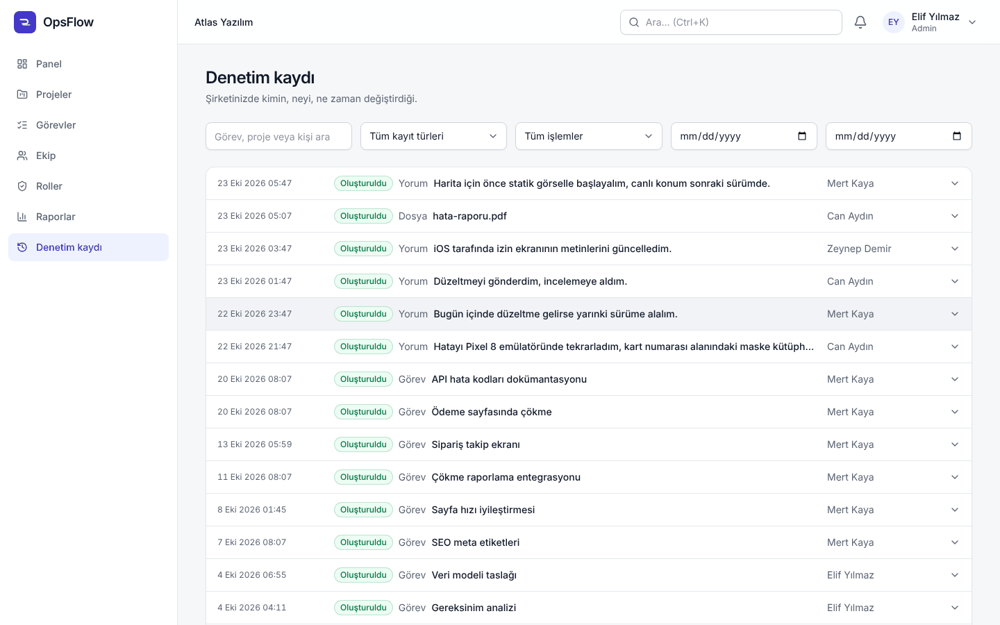
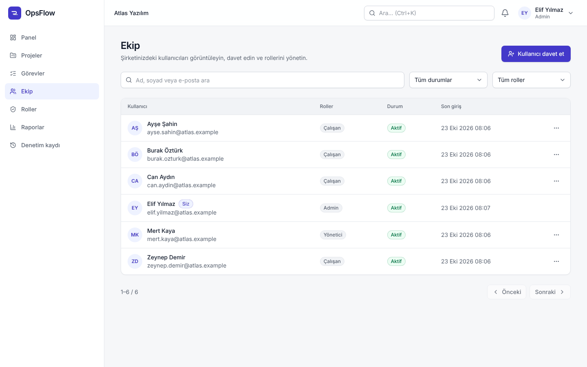
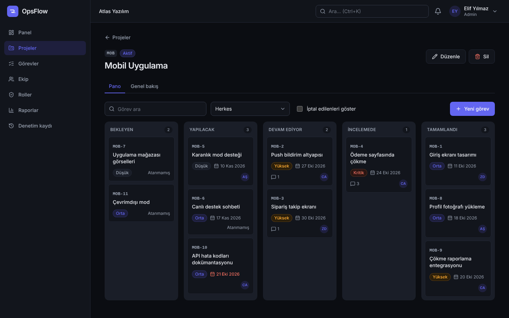
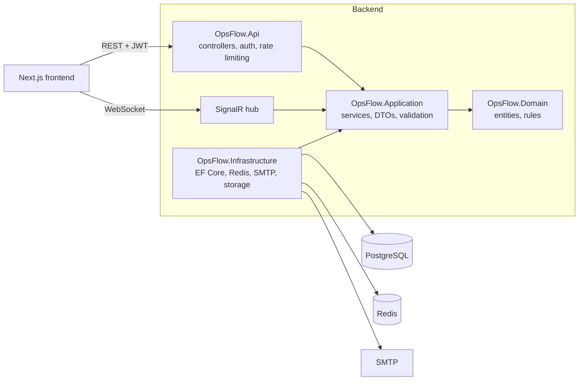

# OpsFlow

[](https://github.com/ardakucuk1232/opsflow/actions/workflows/ci.yml)

OpsFlow is a multi-tenant project and team management platform: a Kanban board and task tracker in the spirit of Jira and Trello, combined with a small company admin panel. Any company can sign up, invite its team, assign roles and run its projects in a workspace that is completely isolated from every other company.

The backend is an ASP.NET Core (.NET 10) REST API built with Clean Architecture; the frontend is a Next.js and TypeScript app. The user interface is in Turkish.



## Contents

- [Features](#features)
- [Screenshots](#screenshots)
- [Tech stack](#tech-stack)
- [Architecture](#architecture)
- [Multi-tenancy](#multi-tenancy)
- [Security](#security)
- [Getting started](#getting-started)
- [Configuration](#configuration)
- [Testing](#testing)
- [CI](#ci)
- [Project structure](#project-structure)

## Features

**Accounts and companies**
- Company sign-up creates the workspace and its first admin in one step
- Email verification, password reset and invitation-based onboarding
- JWT access tokens with rotating refresh tokens and session revocation

**Team and permissions**
- Invite users by email, activate or deactivate them, change their roles
- Three built-in roles (Admin, Manager, Employee) plus custom roles built from 16 fine-grained permissions
- Project-level membership with a lead role; employees only see the projects they belong to

**Projects and tasks**
- Projects with a short key (`MOB`), status, dates and members
- Kanban board with drag and drop across Backlog, To do, In progress, In review and Done
- Task keys per project (`MOB-4`), priority, assignee, due date, comments and file attachments
- "My tasks" view and a quick search (`Ctrl+K`) over task titles

**Visibility**
- Personal dashboard: open, overdue, due this week and recently completed tasks
- Reports: weekly created vs completed tasks, status and priority breakdown, workload per person and progress per project
- Real-time notifications over SignalR (task assigned, status changed, new comment, added to a project)
- Audit log of who changed what and when, with before and after values

## Screenshots

| | |
|---|---|
|  **Dashboard** of an employee |  **Task details** with attachments and comments |
|  **Reports** across all projects |  **Audit log** |
|  **Team** management |  **Dark mode** follows the system theme |

The screenshots use demo data for a fictional company.

## Tech stack

| Area | Technologies |
|---|---|
| Backend | C#, ASP.NET Core (.NET 10), EF Core, PostgreSQL, Redis, SignalR, FluentValidation, Serilog |
| Frontend | Next.js 16 (App Router), React 19, TypeScript, Tailwind CSS 4, React Hook Form, Zod |
| Testing | xUnit, Testcontainers, Vitest, Testing Library, Playwright |
| DevOps | Docker, Docker Compose, GitHub Actions, Dependabot |

## Architecture

The backend follows Clean Architecture with a service layer. Dependencies point inwards, and an architecture test suite fails the build if a layer references one it should not.



| Project | Responsibility |
|---|---|
| `OpsFlow.Domain` | Entities, enums, permission codes and domain exceptions. No framework dependencies. |
| `OpsFlow.Application` | Use cases as services (`ProjectService`, `TaskService`, ...), DTOs, validators and the interfaces infrastructure implements. |
| `OpsFlow.Infrastructure` | EF Core `DbContext`, configurations, migrations and interceptors; Redis cache, JWT, BCrypt, SMTP, file storage. |
| `OpsFlow.Api` | Controllers, authentication and permission policies, rate limiting, CORS, ProblemDetails, SignalR hub, health checks. |

A few decisions worth calling out:

- **Service layer instead of CQRS/MediatR.** The domain is CRUD-heavy, so a service per feature keeps the code direct without adding indirection that would not pay for itself here.
- **Errors as ProblemDetails.** Successful calls return a DTO or a paged result; every error is an RFC 9457 ProblemDetails with a stable `code` the frontend can map to a message.
- **Caching with a fallback.** Permission lookups and reports are cached in Redis. If Redis is unavailable, a circuit breaker switches to in-memory caching for 30 seconds instead of failing requests.
- **Migrations as a separate step.** The API never migrates the database on startup. `dotnet OpsFlow.Api.dll --migrate` applies pending migrations and exits, and Docker Compose runs it as a one-shot container before the API starts.

## Multi-tenancy

All companies share one database. Every tenant-owned table has a `CompanyId` column, and isolation is enforced in several independent layers so that a single mistake cannot leak data:

1. **Tenant from the token only.** The company is read from the JWT, never from the URL, the query string or the request body.
2. **Global query filters.** EF Core adds `WHERE CompanyId = @current` to every query on tenant entities. An architecture test fails if a new tenant entity is added without the filter.
3. **Save guard.** A `SaveChanges` interceptor stamps `CompanyId` on new rows and rejects any insert, update or delete that targets another company.
4. **Composite foreign keys.** Relations between tenant tables include `CompanyId` in the foreign key, so the database itself refuses a task that points to another company's project or user.
5. **404, not 403.** Requesting another company's resource returns 404, so IDs from other tenants cannot even be probed for existence.
6. **Side channels follow the same rules.** Cache keys include the company ID, and a SignalR connection takes its tenant from the token and can only join the live board of a project the user is allowed to see.

Integration tests create two companies and have one try to read, change, assign, comment on and download the other's data through every endpoint that takes an ID, and check that lists and search never return foreign rows. A Playwright test does the same through the UI by pasting another company's URLs.

## Security

| Topic | Implementation |
|---|---|
| Passwords | BCrypt (enhanced, work factor 12) |
| Access tokens | HS256 JWT, 15-minute lifetime, issuer, audience and algorithm validated, 30 s clock skew |
| Refresh tokens | 7-day lifetime, stored as SHA-256 hashes, rotated on every use. Reusing an old token revokes all of the user's sessions. |
| One-time tokens | Email verification, password reset and invitation tokens are random, hashed at rest, single-use and time-limited |
| Authorization | Permission-based policies (`[HasPermission("task.assign")]`) on top of role membership, plus project membership checks |
| Input validation | FluentValidation validators for request bodies and query parameters, length limits mirrored in the database schema |
| File uploads | Extension allow-list, file signature (magic bytes) check, 10 MB limit, files served as downloads with `nosniff` |
| Rate limiting | Per-IP fixed window on auth endpoints (10/min) and session endpoints (60/min), 429 with `Retry-After` |
| CORS | Explicit origin allow-list from configuration |
| HTTP headers | Content Security Policy, `X-Frame-Options: DENY`, `nosniff`, strict referrer and permissions policies |
| Reverse proxy | Forwarded headers are only trusted from configured proxies |
| Audit | Changes are logged with old and new values; password hashes are masked, tokens and storage paths are never recorded |
| Secrets | No secrets in the repository. Local development uses .NET user secrets, Docker reads them from `.env`, CI generates them per run. |

In the browser the access token is kept in memory only. The refresh token is kept in `localStorage` so that a session survives a page reload; the strict CSP is what limits the XSS exposure of that choice. An HttpOnly cookie would be the next step for a production deployment.

## Getting started

### Option 1: run everything with Docker

Requires Docker Desktop.

```bash
cp .env.example .env
```

Fill in the passwords in `.env` and generate a JWT signing key (at least 32 random bytes, base64):

```bash
openssl rand -base64 48
```

On Windows PowerShell:

```powershell
$b = New-Object byte[] 48; [System.Security.Cryptography.RandomNumberGenerator]::Create().GetBytes($b); [Convert]::ToBase64String($b)
```

Then start the stack:

```bash
docker compose --profile app up -d --build
```

| Service | URL |
|---|---|
| Web app | http://localhost:3000 |
| API health check | http://localhost:8080/health |
| Mailpit (captured emails) | http://localhost:8025 |

Open the web app and register a company. Verification, invitation and password reset emails show up in Mailpit.

Stop the stack with `docker compose --profile app down`. Data is kept in Docker volumes.

### Option 2: local development

Requires the .NET 10 SDK, Node.js 22 and Docker.

**1. Start PostgreSQL, Redis and Mailpit**

```bash
cp .env.example .env
docker compose up -d
```

**2. Configure the API with user secrets**

```bash
cd backend/src/OpsFlow.Api
dotnet user-secrets set "ConnectionStrings:Postgres" "Host=localhost;Port=5432;Database=opsflow;Username=opsflow;Password=<POSTGRES_PASSWORD from .env>"
dotnet user-secrets set "ConnectionStrings:Redis" "localhost:6379,password=<REDIS_PASSWORD from .env>"
dotnet user-secrets set "Jwt:SigningKey" "<generated key>"
```

**3. Apply migrations and run the API**

```bash
dotnet run -- --migrate
dotnet run
```

The API listens on https://localhost:7080. Swagger UI is available at https://localhost:7080/swagger in development. If the browser rejects the certificate, run `dotnet dev-certs https --trust` once.

**4. Run the frontend**

```bash
cd frontend
npm ci
npm run dev
```

Open http://localhost:3000. The frontend calls `https://localhost:7080` by default; set `NEXT_PUBLIC_API_URL` in `frontend/.env.local` to change it.

## Configuration

The API reads standard ASP.NET Core configuration: `appsettings.json`, user secrets in development and environment variables (`Section__Key`) everywhere else.

| Setting | Description | Default |
|---|---|---|
| `ConnectionStrings:Postgres` | PostgreSQL connection string | required |
| `ConnectionStrings:Redis` | Redis connection string. Empty means in-memory cache. | empty |
| `Jwt:SigningKey` | Base64 key, at least 32 bytes | required |
| `Jwt:AccessTokenMinutes` / `Jwt:RefreshTokenDays` | Token lifetimes | 15 / 7 |
| `Cors:AllowedOrigins` | Allowed frontend origins | `http://localhost:3000` in development |
| `Frontend:BaseUrl` | Used to build links in emails | `http://localhost:3000` in development |
| `Email:*` | SMTP host, port, security mode, credentials, sender | Mailpit in development |
| `RateLimiting:*` | Permit limits and windows for auth and session endpoints | 10/min, 60/min |
| `Storage:RootPath` / `Storage:MaxFileSizeBytes` | Attachment storage | `App_Data/uploads`, 10 MB |
| `ForwardedHeaders:*` | Enable and list trusted proxies and networks | disabled |
| `HttpsRedirection:Enabled` | Turn off when TLS ends at a proxy | `true` |

The Docker Compose variables are documented in [`.env.example`](.env.example).

## Testing

```bash
# Backend: unit, integration and architecture tests (needs Docker for Testcontainers)
cd backend
dotnet test

# Frontend: lint, type check and unit tests with coverage thresholds
cd frontend
npm run lint
npm run typecheck
npm run test:coverage

# End-to-end: needs the API and the web app running
npx playwright install chromium
npm run test:e2e
```

| Suite | What it covers |
|---|---|
| `OpsFlow.UnitTests` | Token handling, pagination, file type detection, email templates, caching and tenancy helpers |
| `OpsFlow.IntegrationTests` | Every endpoint against real PostgreSQL and Redis containers: auth flows, permissions, cross-tenant access, rate limiting, CORS, SignalR, caching |
| `OpsFlow.ArchitectureTests` | Layer dependencies, controller conventions, tenant and soft-delete query filters on every entity |
| Vitest | Components, forms, API client and session handling, with coverage thresholds enforced |
| Playwright | Sign-up, sign-in, project and task flow, search and tenant isolation in a real browser, on desktop and mobile viewports |

## CI

GitHub Actions runs on every pull request and every push to `main`:

1. **Backend**: restore, build (warnings are errors), run all test projects and publish a coverage summary
2. **Frontend**: lint, type check, unit tests with coverage and a production build
3. **End-to-end**: builds the Docker images, starts the full stack with Docker Compose using generated secrets and runs the Playwright suite against it

Branch protection on `main` requires all three jobs to pass. Dependabot keeps NuGet, npm, GitHub Actions and Docker dependencies up to date.

## Project structure

```
.
├── backend
│   ├── src
│   │   ├── OpsFlow.Api               # HTTP layer, auth, SignalR hub
│   │   ├── OpsFlow.Application       # services, DTOs, validators
│   │   ├── OpsFlow.Domain            # entities and rules
│   │   └── OpsFlow.Infrastructure    # EF Core, Redis, SMTP, storage
│   ├── tests
│   │   ├── OpsFlow.UnitTests
│   │   ├── OpsFlow.IntegrationTests
│   │   └── OpsFlow.ArchitectureTests
│   └── Dockerfile
├── frontend
│   ├── src
│   │   ├── app                       # Next.js routes
│   │   ├── components                # feature and UI components
│   │   └── lib                       # API client, session, helpers
│   ├── e2e                           # Playwright tests
│   └── Dockerfile
├── docs/screenshots
├── docker-compose.yml
└── .github                           # CI workflow and Dependabot
```
